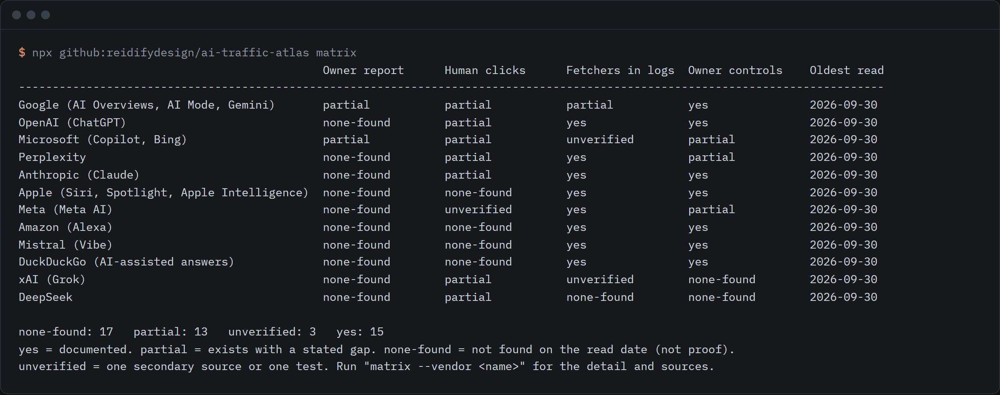

# ai-traffic-atlas

A dated matrix of what each AI system shows a site owner, with the gaps stated and a GA4 template for the traffic you can see.



```sh
npx github:reidifydesign/ai-traffic-atlas matrix
```

Needs Node 18 or later. No dependencies. Everything runs on your machine and reads local files.

## Why this exists

On 2026-09-30 the ways to see AI traffic had changed three times in eight months, and the pages that describe them disagree. Bing Webmaster Tools added an AI Performance report on 2026-02-10. GA4 added a native AI Assistant channel on 2026-05-13. Google added Generative AI reports to Search Console on 2026-06-03 and finished the worldwide rollout on 2026-08-31. Older articles still say GA4 has no AI channel, and one publisher notes that about its own earlier version. Google's own help pages disagree about whether Claude is in the GA4 channel.

This repo puts those facts in one place, one cell per vendor and question, each with a source URL and the date it was read. Where a vendor shows a site owner nothing, the cell says `none-found` instead of staying blank. It also carries a GA4 and Looker Studio template for the traffic that can be identified, and a labelled "suspicious direct" view for the part that cannot.

It is not the only way to classify AI referrers in GA4. MeasureU publishes a free Looker Studio template with a long domain list. This repo adds the vendor matrix, the log and bot side, the ads note, and a direct-traffic filter that refuses to call itself an estimate.

## Use it

```sh
# Reference, all dated and sourced
npx github:reidifydesign/ai-traffic-atlas matrix                      # the grid above
npx github:reidifydesign/ai-traffic-atlas matrix --vendor perplexity  # one vendor, full text and source URLs
npx github:reidifydesign/ai-traffic-atlas stale --days 60             # which cells need a re-read
npx github:reidifydesign/ai-traffic-atlas bots --role user-fetch      # documented fetcher tokens
npx github:reidifydesign/ai-traffic-atlas ads                         # ads in AI answers, what changes for reporting
npx github:reidifydesign/ai-traffic-atlas validate                    # the data files are consistent

# Your own data
npx github:reidifydesign/ai-traffic-atlas template regex              # host regex for a GA4 channel group
npx github:reidifydesign/ai-traffic-atlas template looker             # Looker Studio calculated field
npx github:reidifydesign/ai-traffic-atlas template ga4                # GA4 and Explore steps
npx github:reidifydesign/ai-traffic-atlas template bigquery           # SQL for the BigQuery export
npx github:reidifydesign/ai-traffic-atlas classify export.csv         # split a GA4 export
npx github:reidifydesign/ai-traffic-atlas logs access.log             # count AI fetchers in a server log
```

Read the full matrix without installing anything: [docs/MATRIX.md](docs/MATRIX.md). The other reading is in [docs/GA4-TEMPLATE.md](docs/GA4-TEMPLATE.md), [docs/SUSPICIOUS-DIRECT.md](docs/SUSPICIOUS-DIRECT.md) and [docs/ADS.md](docs/ADS.md).

### Classifying a GA4 export

`classify` reads a CSV from a GA4 Explore free-form export or a Looker Studio table. It needs Sessions and either "Session source / medium" or separate source and medium columns. A landing page column and a New users column make the direct filter work.

This output is from [examples/ga4-export.csv](examples/ga4-export.csv), which is synthetic data written for the demo, not traffic from any real site:

```
category              rows  sessions    share
ai-native                1         8     2.4%
ai-referrer              4        20     5.9%
suspicious-direct        3        29     8.6%
direct-other             3        60    17.8%
other                    5       221    65.4%
```

The command also prints the vendors found, the landing pages behind the suspicious-direct rows, and a reminder of what the numbers mean. Flags: `--min-new-share 0.8`, `--exclude-paths /login,/contact`, `--extra-referrers you.com,phind.com`, `--json`.

### Reading a server log

`logs` reads a combined or common format access log and counts requests from the AI fetchers that vendors document, grouped by role: training, search-index, user-fetch, answer-fetch, ads-check. It also counts human clicks whose referrer names an AI system. See [examples/access.log](examples/access.log), also synthetic.

### Keeping the matrix current

Every cell carries a read date, and `stale` lists the ones older than a limit. To update a cell, re-read the vendor page, edit `data/matrix.json` (status, text, sources, read date), add any new page to `data/sources.json`, then run `npm run docs` and `npm test`. The tests refuse a cell with no source, a `yes` that rests only on a third party, and docs that have drifted from the data. A monthly check is included in `.github/workflows/stale-check.yml` and is switched off until launch.

## What it does not do

- It does not measure your traffic. It classifies an export you give it, and the first two categories are a floor, not the total.
- It does not estimate how many AI visits are hidden in Direct. The suspicious-direct view is a filter, and bookmarks, email links and app links pass it too. There is no error bar because there is no ground truth.
- It cannot see AI answers that mention you without a link, or citations that nobody clicks. Search Console's report counts impressions of cited URLs only, and Bing's counts citations.
- `none-found` means nothing turned up in the pages read on the read date. It is not proof that a vendor has no report or no crawler.
- Several cells rest on a third party or a single test, and are marked `unverified`. Open questions are written as `[[CONFIRM: ...]]` in the data and docs, for example how Copilot clicks are referred and what GA4's full AI Assistant list contains. Microsoft's own pages read on 2026-09-30 did not state the Copilot referrer, and no full GA4 list was found on the Analytics Help pages read.
- OpenAI's own ads pages returned an access block to an automated fetch on 2026-09-30. They were then read in a real browser the same day, and the ads note cites them. One item, the carousel of ad cards, still rests on trade press and is marked.
- The Looker Studio formula and the BigQuery SQL were written against the documented field names and have not been run against a live account. Check them on a known month before trusting them.
- Vendors change these features monthly. Treat any cell older than two months as a prompt to re-read the source.
- It covers ChatGPT ads only. Other vendors' ad programmes were not read.

## Licence

MIT. Built by [@rishsadh](https://github.com/rishsadh) at [Reidify](https://reidify.design).
